<div align="center">

<!-- Hero Animated Banner -->


<br/>

<p align="center">
  <b>Computer Systems Engineer</b> &bull; <b>AI Solutions Architect</b> &bull; <b>Full-Stack Developer</b>
</p>

<p align="center">
  <a href="mailto:samyemen987@gmail.com"></a>
  <a href="https://github.com/Abdulghani780/Abdulghani-AlShibami-Portfolio"></a>
  <a href="https://github.com/Abdulghani780"></a>
</p>

</div>

---

### 🏛️ Executive Summary & Identity

> *"Engineering resilient systems at the intersection of enterprise software architecture, intelligent algorithms, and modern web platforms."*

مرحباً بك! أنا **عبدالغني الشبامي (Abdulghani Al-Shibami)**، مهندس نظم حاسوب ومطور برمجيات متكامل. أركز على هندسة الحلول البرمجية عالية الكفاءة والموثوقية، من أنظمة سطح المكتب للمؤسسات الكبرى (Enterprise Desktop Systems) إلى خوارزميات الذكاء الاصطناعي ومحطات المحاكاة العلمية، وحتى منصات الويب الحديثة المبنية بأحدث معايير الأداء والـ UI/UX الفاخر.

```bash
$ identity --verbose
──────────────────────────────────────────────────────────────────
NAME          : Abdulghani Ali Al-Shibami (عبدالغني الشبامي)
ROLE          : Computer Systems Engineer | Full-Stack & AI Solutions
EDUCATION     : Information Technology & Computer Systems
LOCATION      : Sana'a, Yemen 🇾🇪 (Open to Worldwide Remote Contracts)
CORE FOCUS    : High-Reliability Desktop ERPs • AI & Optimization • Cloud Web
STATUS        : Open for Architectural Challenges & High-Impact Projects
──────────────────────────────────────────────────────────────────
```

---

### 🏆 Flagship Verified Projects

A curated selection of authentic, production-grade systems engineered from scratch:

<table>
  <tr>
    <td width="50%" valign="top">
      <h3 align="left">🖥️ Campus IT Tracker</h3>
      <p><b>Enterprise Infrastructure & Hardware Management System</b></p>
      <p>A mission-critical enterprise desktop workstation engineered for institutional hardware asset lifecycles, lab maintenance, and departmental tracking.</p>
      <ul>
        <li><b>Stack:</b> C# .NET 4.8 &bull; Windows Forms &bull; Oracle Database &bull; PL/SQL</li>
        <li><b>Architecture:</b> Multi-tiered relational schemas, transaction integrity, automated status reporting.</li>
      </ul>
      <p>🔗 <b>Repository:</b> <a href="https://github.com/Abdulghani780/Campuse-IT-Tracker"><code>Abdulghani780/Campuse-IT-Tracker</code></a></p>
    </td>
    <td width="50%" valign="top">
      <h3 align="left">🔬 MetaAlgorithm Lab</h3>
      <p><b>Scientific Algorithmic Optimization & Analysis Workstation</b></p>
      <p>Interactive GUI platform implementing metaheuristic algorithms (Genetic, Particle Swarm, Simulated Annealing) with dynamic convergence visualizers.</p>
      <ul>
        <li><b>Stack:</b> Python 3.10+ &bull; PyQt6 &bull; SciPy &bull; NumPy &bull; Matplotlib</li>
        <li><b>Features:</b> Real-time parameter tuning, benchmark mathematical landscapes, dynamic telemetry.</li>
      </ul>
      <p>🔗 <b>Repository:</b> <a href="https://github.com/Abdulghani780/MetaAlgorithmLab"><code>Abdulghani780/MetaAlgorithmLab</code></a></p>
    </td>
  </tr>
  <tr>
    <td width="50%" valign="top">
      <h3 align="left">✨ Autonomous Personal Portfolio</h3>
      <p><b>Production-Grade Bilingual Identity & Demo Platform</b></p>
      <p>Luxury dark/gold web platform with in-browser client-side project sandboxes (simulating WinForms & Python without server dependencies).</p>
      <ul>
        <li><b>Stack:</b> Next.js 15 &bull; React 19 &bull; TypeScript &bull; Supabase &bull; Tailwind CSS &bull; Lenis</li>
        <li><b>Quality:</b> WCAG AA compliance, 30 prerendered static routes, strict Zod validation.</li>
      </ul>
      <p>🔗 <b>Repository:</b> <a href="https://github.com/Abdulghani780/Abdulghani-AlShibami-Portfolio"><code>Abdulghani780/Abdulghani-AlShibami-Portfolio</code></a></p>
    </td>
    <td width="50%" valign="top">
      <h3 align="left">🎓 Graduation Project Management Portal</h3>
      <p><b>Academic Governance & Defense Workflow Platform</b></p>
      <p>Comprehensive university management solution orchestrating student team proposals, supervisor assignments, committee evaluations, and milestone defenses.</p>
      <ul>
        <li><b>Stack:</b> PHP 8 &bull; MySQL 8 &bull; Bootstrap 5 &bull; MVC Architecture</li>
        <li><b>Security:</b> Strict RBAC (Student / Advisor / Committee / Admin), audit logging.</li>
      </ul>
      <p>🔗 <b>Repository:</b> <a href="https://github.com/Abdulghani780/Graduation-Project-Management-Portal"><code>Abdulghani780/Graduation-Project-Management-Portal</code></a></p>
    </td>
  </tr>
</table>

---

### 🛠️ Technical Arsenal & Ecosystem

<div align="center">

| Domain | Technologies & Frameworks |
|---|---|
| **Enterprise & Systems** |     |
| **AI & Scientific Computing** |     |
| **Modern Web & Full-Stack** |     |
| **Backend & Databases** |     |
| **DevOps & Tooling** |     |

</div>

---

### 📊 Engineering Telemetry & Activity

<div align="center">
  <table border="0">
    <tr>
      <td>
        
      </td>
      <td>
        
      </td>
    </tr>
  </table>
</div>

---

### 🐍 Contribution Activity Stream

<div align="center">
  <picture>
    <source media="(prefers-color-scheme: dark)" srcset="https://raw.githubusercontent.com/Abdulghani780/Abdulghani780/output/github-contribution-grid-snake.svg" />
    <source media="(prefers-color-scheme: light)" srcset="https://raw.githubusercontent.com/Abdulghani780/Abdulghani780/output/github-contribution-grid-snake.svg" />
    
  </picture>
</div>

---

<div align="center">

<!-- Footer Banner -->


</div>
